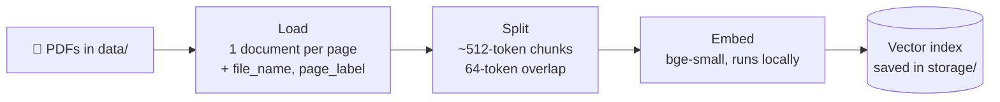
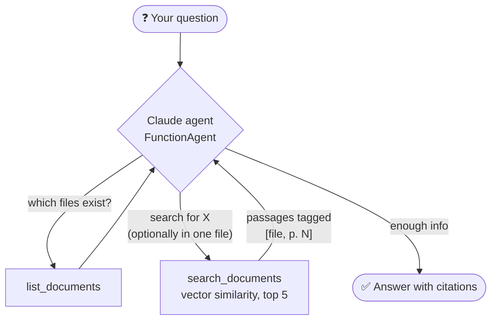

# 📄 PDF Q&A Agent: chat with your documents

An AI agent that **answers questions about your PDF files with page-level citations**, built with **LlamaIndex** and **Claude**. It uses **free local embeddings**, so the only API key you need is Anthropic's.

Drop PDFs (contracts, research papers, manuals, course notes...) into the `data/` folder and ask questions in plain language. The agent decides what to search for and which documents to search, reads the relevant passages, and answers with sources like *(handbook.pdf, p. 3)*.

```text
$ python main.py
📄 Loading and indexing PDFs...
✅ Ready! Ask anything about your documents.

You: How many vacation days do I get, and can I carry them over?
   🔎 searching: "paid vacation days per year"
   🔎 searching: "carry over unused vacation days"

🤖 You get 27 days of paid vacation per year, plus the public holidays of your
   country of residence (nova_labs_handbook.pdf, p. 2).
   • Up to 5 unused days can be carried over to the next year
   • Carried-over days must be used before 31 March (nova_labs_handbook.pdf, p. 2)

You: And what's the travel hotel limit in Paris?
   🔎 searching: "hotel limit per night Paris"

🤖 The hotel limit is 250 EUR per night in Paris (the standard limit is 180 EUR)
   (nova_labs_handbook.pdf, p. 3).
```

---

## ✨ Features

- **Agentic retrieval**: Claude decides *what* to search, can search several times with different wording, and can target one specific PDF (useful for comparing documents)
- **Page citations** on every fact, so you can verify answers
- **Conversation memory**: follow-up questions like *"and in Paris?"* work
- **Free local embeddings** (`BAAI/bge-small-en-v1.5` via Hugging Face). No OpenAI key needed.
- **Smart caching**: the index is saved to disk and rebuilt only when your PDFs change
- **"I don't know" behavior**: it says so when the answer isn't in your documents instead of making something up
- **Two interfaces**: command-line chat and a Streamlit chat app with PDF upload
- **Sample PDF included**: a fictional company handbook, so you can try it right away

---

## 🧠 How it works

The project has two phases: **indexing** (once, cached) and **answering** (every question).

### Phase 1: Indexing (RAG pipeline)



1. **Load**: `SimpleDirectoryReader` reads each PDF page as a document and keeps metadata (`file_name`, `page_label`). That metadata is what makes page citations possible.
2. **Split**: `SentenceSplitter` cuts pages into chunks of about 512 tokens, with an overlap so sentences aren't cut in the middle of an idea.
3. **Embed**: each chunk becomes a vector (a list of numbers that captures its *meaning*) using a small, free model that runs on your computer.
4. **Store**: the vectors are saved in `storage/`. A fingerprint of your PDFs (names, sizes, dates) is saved too. If nothing changed, the next start loads instantly.

### Phase 2: Answering (the agent)



The agent is a LlamaIndex **`FunctionAgent`**: Claude plus a list of **tools** (plain Python functions). Claude reads the question, decides which tool to call and with what arguments, reads the result, and repeats until it can answer.

| Tool | What it does |
|------|--------------|
| `list_documents()` | Returns the available PDFs and their page counts |
| `search_documents(query, file_name=None)` | Embeds the query, finds the 5 most similar chunks (optionally only in one file), and returns them tagged with `[file, p. N]` |

### Key concepts (useful when explaining this project to others)

- **RAG (Retrieval-Augmented Generation)**: instead of hoping the LLM *knows* your documents, we **retrieve** the relevant passages and give them to the model as context. The model answers from evidence, not from memory.
- **Embeddings & semantic search**: texts with similar meaning get similar vectors. A search for "vacation" also finds passages about "paid time off", which keyword search would miss.
- **Chunking**: LLMs and embeddings work best on focused pieces of text. Too big and the meaning gets diluted. Too small and context is lost. The overlap keeps ideas intact across chunk boundaries.
- **Agentic RAG vs. classic RAG**: classic RAG always does *one* search using your exact question. Here the **agent** rewrites queries, searches multiple times and filters by file. That's much better for multi-part questions and comparisons.
- **Tools from plain functions**: `FunctionTool.from_defaults(fn=...)` turns a Python function into a tool. Its **docstring and type hints** become the description Claude reads, so write them well!
- **Memory**: a `ChatMemoryBuffer` keeps the chat history between questions, so follow-ups work. `reset` creates a fresh one.
- **Grounding**: the system prompt tells Claude to answer *only* from retrieved passages and to cite them. That's the main defense against hallucination.

---

## 🚀 Getting started

### 1. Prerequisites

- Python **3.10+**
- An **Anthropic API key**: [console.anthropic.com](https://console.anthropic.com)

### 2. Install

```bash
git clone https://github.com/Shadab995/pdf-qa-agent.git
cd pdf-qa-agent

python -m venv .venv
source .venv/bin/activate        # Windows: .venv\Scripts\activate

pip install -r requirements.txt
```

> ℹ️ The local embedding model uses PyTorch, so the install is a few hundred MB. The first run also downloads the embedding model (~130 MB) once.

### 3. Configure

```bash
cp .env.example .env             # Windows: copy .env.example .env
```

Then add your `ANTHROPIC_API_KEY` to `.env`.

### 4. Add your PDFs

Put your PDF files in the `data/` folder. A sample (`nova_labs_handbook.pdf`, a fictional company handbook) is already there.

### 5. Run it

**Command-line chat:**

```bash
python main.py
python main.py --pdf-dir ~/Documents/papers     # another folder
python main.py --rebuild                        # force re-indexing
```

**Web app (with PDF upload):**

```bash
streamlit run app.py
```

Then open http://localhost:8501.

**From your own Python code:**

```python
from pdf_agent import PDFAgent

agent = PDFAgent(pdf_dir="data")
print(agent.ask("What is the learning budget per year?"))
print(agent.ask("Does unused budget roll over?"))   # follow-up, uses memory
```

### Example questions for the sample PDF

- What are the core working hours?
- How long can I work from a country where Nova Labs has no entity?
- Summarize the parental leave policy.
- What do I need to do if my laptop is stolen?
- What is the company's stock option policy? *(not in the document, so it should say it couldn't find it)*

---

## 📁 Project structure

```text
pdf-qa-agent/
├── pdf_agent.py        # Indexing, tools and the agent (start reading here)
├── main.py             # Command-line chat
├── app.py              # Streamlit chat app with PDF upload
├── data/
│   └── nova_labs_handbook.pdf   # Sample PDF (fictional company)
├── storage/            # Saved vector index (auto-created, git-ignored)
├── requirements.txt
├── .env.example
└── README.md
```

---

## ⚙️ Configuration

| Setting | Where | Default | Notes |
|---------|-------|---------|-------|
| `CLAUDE_MODEL` | `.env` / `--model` | `claude-haiku-5-5` | Use a bigger model (e.g. `claude-sonnet-5-5`) for harder documents |
| `EMBED_MODEL` | `.env` | `BAAI/bge-small-en-v1.5` | Any Hugging Face embedding model. For multilingual PDFs try `BAAI/bge-m3`. |
| `PDF_DIR` | `.env` / `--pdf-dir` | `data` | Folder with your PDFs |
| `chunk_size` / `chunk_overlap` | `configure_models()` | 512 / 64 | Smaller chunks give more precise citations; larger chunks give more context |
| `top_k` | `make_tools()` | 5 | Passages returned per search |

> If you change `EMBED_MODEL` or the chunk settings, run with `--rebuild`.

**Cost:** embeddings are free (local). A typical question uses about 3-8k Claude tokens.

**Privacy:** your PDFs are indexed on your machine. Only the retrieved passages (and your question) are sent to the Claude API.

---

## 🛠️ Ideas to extend it

- Support **Word, Markdown and web pages** (`SimpleDirectoryReader` reads many formats)
- Use a real **vector database** (Chroma, Qdrant, pgvector) for thousands of documents
- Add **re-ranking** to improve which passages are kept
- Read **tables and scanned PDFs** with LlamaParse or OCR
- Show the **source passages** next to each answer in the Streamlit app
- Build an **evaluation set** (question → expected answer) to measure accuracy

---

## 📚 Learn more

- [LlamaIndex docs](https://docs.llamaindex.ai/)
- [LlamaIndex agents](https://docs.llamaindex.ai/en/stable/understanding/agent/)
- [Claude API docs](https://docs.claude.com/)

## 📄 License

MIT. See [LICENSE](LICENSE).
